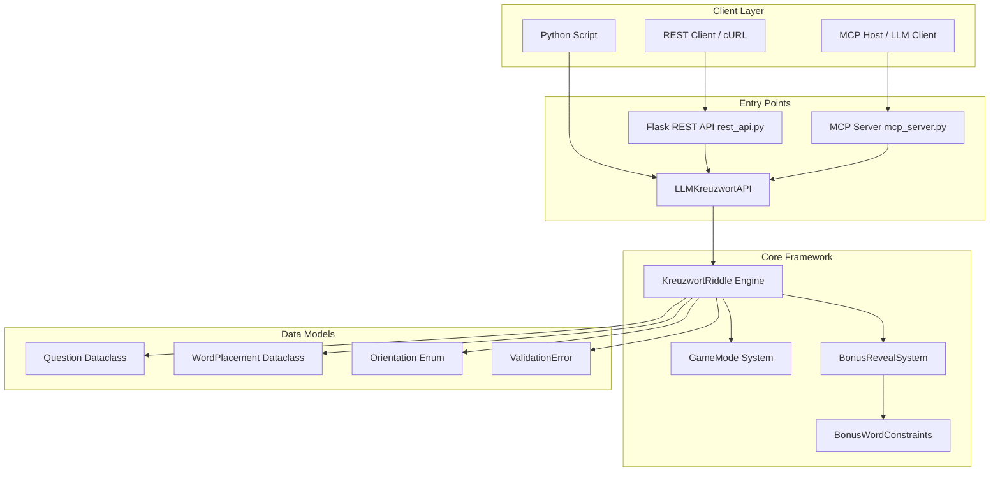
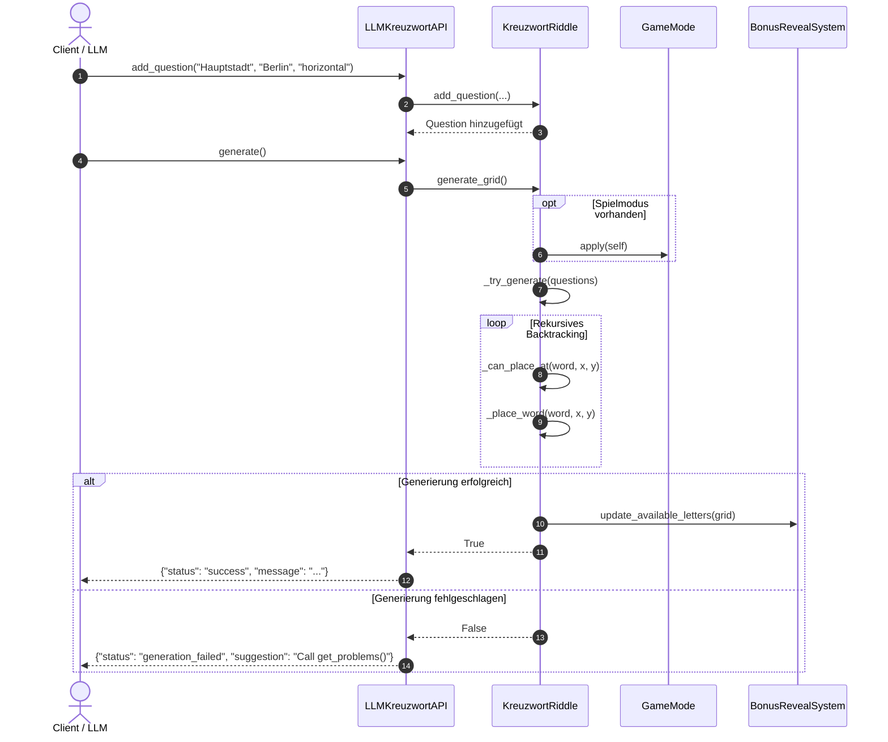
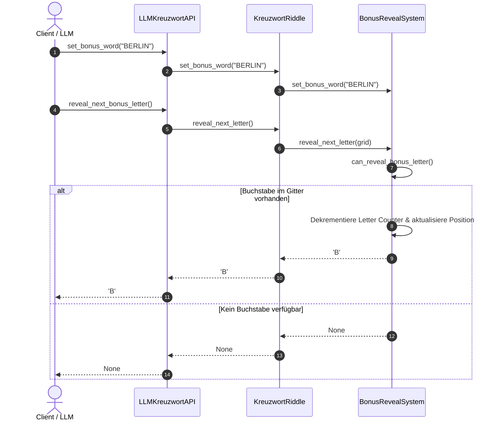
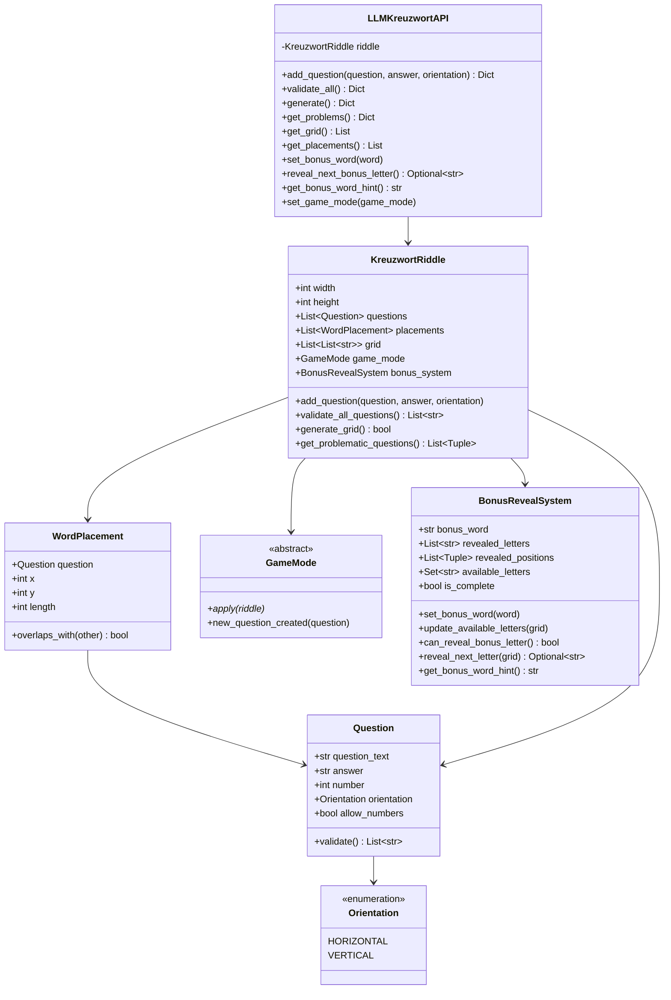

# Crossword Riddle Framework – Entwickler- und Benutzerhandbuch

Willkommen beim offiziellen, vollumfassenden Handbuch für das **Crossword Riddle Framework**.
Dieses Handbuch richtet sich an Endanwender, Prompt-Engineers, Integratoren von Large Language Models (LLMs) sowie Software-Entwickler, die das Framework nutzen, erweitern oder in externe Systeme einbinden möchten.

---

## Inhaltsverzeichnis

- [Teil 1: Benutzerhandbuch (User Manual)](#teil-1-benutzerhandbuch-user-manual)
  - [1.1 Übersicht & Anwendungsbereiche](#11-übersicht--anwendungsbereiche)
  - [1.2 Installation & Systemvoraussetzungen](#12-installation--systemvoraussetzungen)
  - [1.3 Schnellstart (Quickstart)](#13-schnellstart-quickstart)
  - [1.4 Nutzung der Python-API (`LLMKreuzwortAPI`)](#14-nutzung-der-python-api-llmkreuzwortapi)
  - [1.5 Das Bonuswort-System](#15-das-bonuswort-system)
  - [1.6 Spielmodi (GameModes)](#16-spielmodi-gamemodes)
  - [1.7 REST-API Referenz & Nutzung](#17-rest-api-referenz--nutzung)
  - [1.8 MCP-Server Integration (Model Context Protocol)](#18-mcp-server-integration-model-context-protocol)
  - [1.9 Fehlerbehandlung & Troubleshooting](#19-fehlerbehandlung--troubleshooting)
- [Teil 2: Entwicklerhandbuch (Developer Manual)](#teil-2-entwicklerhandbuch-developer-manual)
  - [2.1 Systemarchitektur & Modulübersicht](#21-systemarchitektur--modulübersicht)
  - [2.2 Datenmodelle & Domänenlogik (`models.py`)](#22-datenmodelle--domänenlogik-modelspy)
  - [2.3 Core Framework (`kreuzwortriddle.py`)](#23-core-framework-kreuzwortriddlepy)
  - [2.4 Der Backtracking-Gittergenerator](#24-der-backtracking-gittergenerator)
  - [2.5 Das Bonus-System Interna (`bonus_system.py`)](#25-das-bonus-system-interna-bonus_systempy)
  - [2.6 Erweiterungssystem für Spielmodi (`gamemode.py` & `modes.py`)](#26-erweiterungssystem-für-spielmodi-gamemodepy--modespy)
  - [2.7 REST-API Server Architektur (`rest_api.py`)](#27-rest-api-server-architektur-rest_apipy)
  - [2.8 MCP-Server Architektur (`mcp_server.py`)](#28-mcp-server-architektur-mcp_serverpy)
  - [2.9 Qualitätssicherung, Testing & Pre-Commit](#29-qualitätssicherung-testing--pre-commit)
- [Teil 3: Schemas, Diagramme & Visuelle Darstellungen](#teil-3-schemas-diagramme--visuelle-darstellungen)
  - [3.1 Architektur- & Moduldiagramm (Mermaid)](#31-architektur--moduldiagramm-mermaid)
  - [3.2 Sequenzdiagramme (Workflows)](#32-sequenzdiagramme-workflows)
  - [3.3 Klassendiagramm](#33-klassendiagramm)
  - [3.4 JSON Schemas (REST & MCP)](#34-json-schemas-rest--mcp)
  - [3.5 Visuelle Screenshots & UI Mockups (ASCII Renderings)](#35-visuelle-screenshots--ui-mockups-ascii-renderings)

---

# Teil 1: Benutzerhandbuch (User Manual)

## 1.1 Übersicht & Anwendungsbereiche

Das **Crossword Riddle Framework** ist eine spezialisierte Python-Bibliothek zur automatischen Generierung von Kreuzworträtseln. Es wurde speziell für das Zusammenspiel mit **Large Language Models (LLMs)** entwickelt.

### Hauptzielsetzung
LLMs verfügen über exzellentes Weltwissen und kreative Sprachfähigkeiten, sind jedoch beim Einhalten räumlicher, geometrischer Beschränkungen (z. B. Schnittpunkte in zweidimensionalen Gittern) oft fehleranfällig. Das Crossword Riddle Framework übernimmt die komplette technische Logik:
- Geometrische Platzierung der Wörter im 2D-Gitter per Backtracking
- Kollisions- und Parallelitätsprüfungen
- Automatische Validierung von Fragen und Antworten
- Detailliertes, LLM-optimiertes Fehlerfeedback
- Progressives Aufdecken eines Bonuswortes
- Anbindung über REST API und Model Context Protocol (MCP)

---

## 1.2 Installation & Systemvoraussetzungen

### Voraussetzungen
- **Python:** 3.8 oder höher (getestet mit Python 3.12)
- **Pip:** Standard Python Package Manager

### Installation

1. **Repository klonen:**
   ```bash
   git clone https://github.com/example/crossword-riddle.git
   cd crossword-riddle
   ```

2. **Abhängigkeiten installieren:**
   Für die Kerntools ist keine externe Abhängigkeit erforderlich (Standardbibliothek). Für REST API und MCP Server installieren Sie die optionalen Abhängigkeiten:
   ```bash
   pip install -r requirements.txt
   ```

Inhalte der `requirements.txt`:
- `flask` (für REST-API)
- `flask-cors` (CORS-Unterstützung für REST-API)
- `mcp` (für Model Context Protocol Integration)
- `pytest` (für automatisierte Tests)

---

## 1.3 Schnellstart (Quickstart)

Erstellen Sie ein einfaches Skript `quickstart.py`:

```python
from kreuzwortriddle import LLMKreuzwortAPI

# Initialize API instance with grid size 15x15
api = LLMKreuzwortAPI(width=15, height=15)

# Add questions
api.add_question("Hauptstadt von Deutschland", "Berlin", "horizontal")
api.add_question("Fluss durch Dresden", "Elbe", "vertical")

# Validate inputs
val = api.validate_all()
print("Validierung:", val)

# Generate grid
gen = api.generate()
print("Generierung:", gen)

# Display grid
if gen["status"] == "success":
    grid = api.get_grid()
    print("\nGeneriertes Gitter:")
    for row in grid:
        print(" ".join(cell if cell else "." for cell in row))
```

Ausführen mit:
```bash
python quickstart.py
```

---

## 1.4 Nutzung der Python-API (`LLMKreuzwortAPI`)

Die Klasse `LLMKreuzwortAPI` bietet eine vereinfachte Schnittstelle, die alle Rückgabewerte als Python-Dictionaries mit standardisiertem `"status"`-Feld zurückgibt.

### API-Methodenübersicht

#### `__init__(width: int = 15, height: int = 15)`
Initialisiert das Framework mit der gewählten Gittergröße.

#### `add_question(question: str, answer: str, orientation: str = "horizontal") -> Dict[str, Any]`
Fügt eine neue Frage hinzu.
- **`question`**: Fragetext (z. B. `"Hauptstadt von Frankreich"`)
- **`answer`**: Antwortwort (muss rein alphabetisch sein, 2-20 Zeichen)
- **`orientation`**: `"horizontal"` oder `"vertical"`
- **Rückgabe Erfolg:** `{"status": "success", "message": "Frage erfolgreich hinzugefügt"}`
- **Rückgabe Fehler:** `{"status": "error", "message": "...", "problematic_questions": [...]}`

#### `validate_all() -> Dict[str, Any]`
Prüft alle hinzugefügten Fragen auf Gültigkeit.
- **Rückgabe Erfolg:** `{"status": "valid", "message": "Alle Fragen sind gültig"}`
- **Rückgabe Fehler:** `{"status": "validation_errors", "errors": [...], "suggestion": "..."}`

#### `generate() -> Dict[str, Any]`
Versucht, das Kreuzworträtsel-Gitter zu generieren.
- **Rückgabe Erfolg:** `{"status": "success", "message": "Riddle generated successfully"}`
- **Rückgabe Fehler:** `{"status": "generation_failed", "message": "...", "suggestion": "..."}`

#### `get_problems() -> Dict[str, Any]`
Identifiziert gezielt mathematische/geometrische Konflikte (z. B. unzureichende Kreuzungsmöglichkeiten).
- **Rückgabe:** `{"status": "problems_found", "problems": [(Index, Meldung), ...], "suggestion": "..."}` oder `{"status": "no_problems"}`

#### `get_grid() -> List[List[str]]`
Gibt das 2D-Gitter als Liste von Listen (Zeilen und Spalten) zurück. Leere Zellen enthalten `""`.

#### `get_placements() -> List[Dict[str, Any]]`
Gibt eine Liste von Dictionaries mit genauen Wortpositionen `(x, y)`, Ausrichtung, Nummer und Länge zurück.

#### `set_bonus_word(word: str) -> None`
Setzt das aufzudeckende Bonuswort.

#### `reveal_next_bonus_letter() -> Optional[str]`
Deckt den nächsten verfügbaren Buchstaben des Bonuswortes auf, falls dieser im generierten Gitter existiert.

#### `get_bonus_word_hint() -> str`
Gibt einen formatierten Status-Hinweis zum Bonuswort zurück (z. B. `Bonuswort: B_____ (1/6 Buchstaben, in Arbeit)`).

---

## 1.5 Das Bonuswort-System

Das Bonuswort-System ermöglicht ein spielerisches Enthüllen eines Lösungswortes über die Buchstaben der bereits generierten Antworten.

### Regeln für das Bonuswort:
1. **Länge:** 3 bis 8 Buchstaben.
2. **Zeichensatz:** Nur Buchstaben A–Z.
3. **Gitter-Verfügbarkeit:** Die aufzudeckenden Buchstaben müssen in den Platzierten Antworten des Gitters tatsächlich vorkommen.
4. **Häufigkeitszählung:** Mehrfache Buchstaben (z. B. zwei 'E' in "EUROPE") werden exakt anhand der Häufigkeit im Gitter gezählt und aufgedeckt.

### Beispiel für Bonuswort-Enthüllung:
```python
api.set_bonus_word("BERLIN")

# Nach erfolgreicher Gittergenerierung
print(api.get_bonus_word_hint())  # Bonuswort: ______ (0/6 Buchstaben, in Arbeit)

# Schrittweises Aufdecken
letter1 = api.reveal_next_bonus_letter() # Returns 'B'
print("Aufgedeckt:", letter1)
print(api.get_bonus_word_hint())  # Bonuswort: B_____ (1/6 Buchstaben, in Arbeit)
```

---

## 1.6 Spielmodi (GameModes)

Das Framework bietet ein erweiterbares Modus-System über das `GameMode`-Interface.

### Verfügbare Spielmodi

#### 1. Themenbasiertes Rätsel (`ThemeBasedRiddle`)
Filtert automatisch alle Fragen heraus, deren Fragetext nicht das gewählte Thema enthält.
```python
from modes import ThemeBasedRiddle

api.set_game_mode(ThemeBasedRiddle("Hauptstadt"))
api.add_question("Hauptstadt von Norwegen", "Oslo", "horizontal")
api.add_question("Eine Frucht", "Apfel", "vertical")
api.generate()  # Platziert nur "Oslo"
```

#### 2. Zahlenrätsel (`NumberRiddle`)
Ermöglicht Antworten mit Zahlen (z. B. Jahreszahlen oder Codes).
```python
from modes import NumberRiddle

api.set_game_mode(NumberRiddle())
api.add_question("Jahr der Mondlandung", "1969", "horizontal")
```

#### 3. Umgekehrtes Rätsel (`ReverseRiddle`)
Dreht die Antworten aller Fragen automatisch um (z. B. "HELLO" -> "OLLEH").
```python
from modes import ReverseRiddle

api.set_game_mode(ReverseRiddle())
api.add_question("Grusswort", "Hallo", "horizontal")
```

---

## 1.7 REST-API Referenz & Nutzung

Das Framework stellt eine vollständige REST-API zur Verfügung, die über Flask betrieben wird.

### Server starten
```bash
python rest_api.py
```
Der Server läuft standardmäßig auf `http://0.0.0.0:5000`.

### REST Endpunkte

| HTTP Methode | Endpunkt | Beschreibung |
|---|---|---|
| `POST` | `/api/questions` | Neue Frage hinzufügen |
| `GET` | `/api/validate` | Alle Fragen validieren |
| `POST` | `/api/generate` | Rätsel-Gitter erzeugen |
| `GET` | `/api/problems` | Problematische Fragen abfragen |
| `POST` | `/api/bonus` | Bonuswort setzen |
| `GET` | `/api/bonus` | Bonuswort-Status abfragen |
| `POST` | `/api/bonus/reveal` | Nächsten Bonusbuchstaben aufdecken |
| `GET` | `/api/status` | Server- und Framework-Status abfragen |
| `POST` | `/api/reset` | Session zurücksetzen |

### cURL-Beispiele

#### 1. Frage hinzufügen (`POST /api/questions`)
```bash
curl -X POST http://localhost:5000/api/questions \
  -H "Content-Type: application/json" \
  -d '{
    "question": "Hauptstadt von Deutschland",
    "answer": "Berlin",
    "orientation": "horizontal"
  }'
```

**Antwort:**
```json
{
  "message": "Frage erfolgreich hinzugefügt",
  "status": "success"
}
```

#### 2. Rätsel generieren (`POST /api/generate`)
```bash
curl -X POST http://localhost:5000/api/generate
```

**Antwort:**
```json
{
  "grid": [
    ["", "B", "E", "R", "L", "I", "N", ""],
    ["", "", "L", "", "", "", "", ""]
  ],
  "message": "Riddle generated successfully",
  "placements": [
    {
      "answer": "Berlin",
      "length": 6,
      "number": 1,
      "orientation": "horizontal",
      "question": "Hauptstadt von Deutschland",
      "x": 1,
      "y": 0
    }
  ],
  "status": "success"
}
```

#### 3. Bonuswort setzen (`POST /api/bonus`)
```bash
curl -X POST http://localhost:5000/api/bonus \
  -H "Content-Type: application/json" \
  -d '{"bonus_word": "BERLIN"}'
```

---

## 1.8 MCP-Server Integration (Model Context Protocol)

Das Framework unterstützt das **Model Context Protocol (MCP)**, mit dem LLM-Tools direkt in MCP-fähige Clients wie Claude Desktop, VS Code Erweiterungen oder Cursor eingebunden werden können.

### MCP-Server starten
```bash
python mcp_server.py
```

### Registrierte MCP-Tools

1. `add_question(question, answer, orientation)`: Fügt eine Frage hinzu.
2. `validate_all()`: Validiert alle Fragen.
3. `generate_riddle()`: Generiert das Rätsel-Gitter.
4. `get_problems()`: Liefert Problemanalysen.
5. `set_bonus_word(bonus_word)`: Setzt das Bonuswort.
6. `reveal_bonus_letter()`: Enthüllt den nächsten Bonusbuchstaben.
7. `get_status()`: Statusabfrage.
8. `reset_framework()`: Setzt die Instanz zurück.

---

## 1.9 Fehlerbehandlung & Troubleshooting

### Häufige Fehlerursachen und Lösungen

| Fehlermeldung | Ursache | Lösung |
|---|---|---|
| `"Frage-Text ist leer"` | Der Fragetext ist leer oder enthält nur Leerzeichen. | Einen gültigen Fragetext übergeben. |
| `"Antwort muss mindestens 2 Buchstaben lang sein"` | Die Antwort besteht aus 0 oder 1 Zeichen. | Eine Antwort mit mindestens 2 Zeichen wählen. |
| `"Antwort darf nur Buchstaben enthalten"` | Antwort enthält Zahlen oder Sonderzeichen. | Sonderzeichen entfernen oder `NumberRiddle` Modus aktivieren. |
| `"Antwort hat keine gemeinsamen Buchstaben mit anderen Antworten"` | Die Wortliste enthält isolierte Wörter ohne Schnittpunkte. | Wörter mit übereinstimmenden Buchstaben wählen. |
| `"Antwort '...' ist zu lang für das Gitter"` | Das Wort überschreitet die Gitterdimension. | Gittergröße anpassen (`width`/`height`) oder kürzeres Wort wählen. |


---

# Teil 2: Entwicklerhandbuch (Developer Manual)

## 2.1 Systemarchitektur & Modulübersicht

Das Framework ist modular aufgebaut und folgt den **SOLID**-, **DRY**- und **Readability**-Prinzipien.

```
+-------------------------------------------------------------------+
|                        Integration Layer                          |
|   +-----------------------+           +-----------------------+   |
|   |   rest_api.py (Flask) |           |  mcp_server.py (MCP)  |   |
|   +-----------+-----------+           +-----------+-----------+   |
+---------------+-----------------------------------+---------------+
                |                                   |
                +-----------------+-----------------+
                                  |
+---------------------------------v---------------------------------+
|                            API Layer                              |
|                   LLMKreuzwortAPI (kreuzwortriddle.py)            |
+---------------------------------+---------------------------------+
                                  |
+---------------------------------v---------------------------------+
|                           Core Engine                             |
|                    KreuzwortRiddle (kreuzwortriddle.py)           |
|                                                                   |
|   +-----------------------+           +-----------------------+   |
|   |  grid_generator.py    |           |    bonus_system.py    |   |
|   |    GridGenerator      |           |   BonusRevealSystem   |   |
|   +-----------------------+           +-----------------------+   |
|   +-----------------------+           +-----------------------+   |
|   |       models.py       |           |   gamemode.py / modes |   |
|   | Question, Placement   |           |    GameMode System    |   |
|   +-----------------------+           +-----------------------+   |
+-------------------------------------------------------------------+
```

---

## 2.2 Datenmodelle & Domänenlogik (`models.py`)

Das Modul `models.py` definiert die Kern-Datenstrukturen als immutable/dataclass-Objekte:

### 1. `Orientation(Enum)`
- `HORIZONTAL = "horizontal"`
- `VERTICAL = "vertical"`

### 2. `Question(dataclass)`
```python
@dataclass
class Question:
    question_text: str
    answer: str
    number: int = 0
    orientation: Orientation = Orientation.HORIZONTAL
    allow_numbers: bool = False
```
- **Validierungslogik (`validate()`):** Prüft Nicht-Leere, Mindestlänge (≥2), Maximallänge (≤20) sowie Zeichensätze (`isalpha()` bzw. `isalnum()`).

### 3. `WordPlacement(dataclass)`
Repräsentiert die Platzierung eines Wortes im 2D-Gitter an den Koordinaten `(x, y)`.
```python
@dataclass
class WordPlacement:
    question: Question
    x: int
    y: int
    length: int

    def overlaps_with(self, other: 'WordPlacement') -> bool:
        # Prüft geometrische Schnittmenge zweier Wörter
        ...
```

---

## 2.3 Core Framework (`kreuzwortriddle.py`)

`kreuzwortriddle.py` stellt die zentrale Orchestrierungslogik bereit.

### `KreuzwortRiddle`
Verwaltet den Zustand des Rätsels:
- `questions: List[Question]`
- `placements: List[WordPlacement]`
- `grid: List[List[str]]` (2D-Matrix der Dimension `width` x `height`)
- `game_mode: Optional[GameMode]`
- `bonus_system: BonusRevealSystem`

---

## 2.4 Der Backtracking-Gittergenerator

Das Herzstück der Rätselerstellung ist ein rekursiver **Backtracking-Algorithmus** in `generate_grid()`.

### Algorithmus-Ablauf:
1. **Erstplatzierung:** Das erste Wort wird zentriert im Gitter platziert (horizontal oder vertikal).
2. **Rekursive Platzierung (`_place_remaining`):**
   - Für das nächste nicht platzierte Wort werden **alle bestehenden Platzierungen** durchsucht.
   - Es werden **alle gleichen Buchstaben** identifiziert.
   - Für jede Übereinstimmung wird die Zielposition `(px, py)` berechnet.
   - `_can_place_at()` verifiziert die Platzierung:
     - Innerhalb der Gittergrenzen?
     - Keine Zeichenkonflikte in den Zellen?
     - Keine unerwünschte Parallelberührung von Wörtern?
     - Keine unzulässige Verlängerung eines anderen Wortes vor/nach dem Start/Ende?
3. **Backtracking & Permutationen:**
   - Schlägt ein Ast fehl, setzt der Algorithmus das Gitter und die Platzierungen auf den gesicherten Zustand zurück (`saved_grid`, `saved_placements`).
   - Reicht einfaches Backtracking nicht aus, probiert der Generator Permutationen der Wortreihenfolge (für ≤8 verbleibende Wörter) bzw. Monte-Carlo-Zufallsreihenfolgen (100 Versuche für >8 Wörter).

---

## 2.5 Das Bonus-System Interna (`bonus_system.py`)

Die Klasse `BonusRevealSystem` verwaltet die stufenweise Freischaltung des Bonuswortes:

- **Häufigkeitsanalyse:** `update_available_letters(grid)` scannt das aktuelle 2D-Gitter und speichert die Buchstabenhäufigkeiten in einem `collections.Counter` sowie deren Positionen in `_grid_positions`.
- **Enthüllungsprüfung:** `can_reveal_bonus_letter()` prüft, ob das Bonuswort noch verbleibende Unterstriche `'_'` hat und ob der entsprechende Buchstabe im `Counter` noch mit `count > 0` existiert.
- **Enthüllung:** `reveal_next_letter()` dekrementiert den Zähler, aktualisiert `revealed_letters` und registriert die Koordinaten in `revealed_positions`.

---

## 2.6 Erweiterungssystem für Spielmodi (`gamemode.py` & `modes.py`)

Entwickler können neue Spielmodi durch Vererbung der abstrakten Basisklasse `GameMode` aus `gamemode.py` erstellen:

```python
from gamemode import GameMode

class CustomGameMode(GameMode):
    def apply(self, riddle):
        # Wird unmittelbar vor der Gittergenerierung aufgerufen
        pass

    def new_question_created(self, question):
        # Hook beim Hinzufügen einer Frage (vor der Validierung)
        pass
```

---

## 2.7 REST-API Server Architektur (`rest_api.py`)

Die REST-API nutzt Flask und speichert pro Benutzer-Session eine eigene Instanz von `LLMKreuzwortAPI` und `BonusRevealSystem` in der Flask-`session`. Dadurch ist die API thread-sicher und unterstützt parallele Benutzer.

---

## 2.8 MCP-Server Architektur (`mcp_server.py`)

Der MCP-Server nutzt das offizielle `@mcp.tool()` SDK. Er stellt stdio-basierte Werkzeuge bereit, mit denen LLM-Agents (z. B. Claude) direkt Rätsel generieren, validieren und korrigieren können.

---

## 2.9 Qualitätssicherung, Testing & Pre-Commit

Das Projekt besitzt eine umfassende Test-Suite (`test_framework.py`) mit **49 automatisierten Unit-Tests**.

### Ausführen aller Tests:
```bash
pytest test_framework.py -v
```

### Testabdeckung:
- **Validierung:** Leere Texte, Mindestlänge, Sonderzeichen, Zahlen
- **Gittergenerierung:** 2-Wort, 4-Wort, 5-Wort Kaskaden, Vertikal-Erstplatzierungen
- **Problemanalyse:** Nicht-kreuzbare Wörter, Gitter-Überlänge, Ausrichtungs-Konflikte
- **Bonus-System:** Buchstaben-Counters, Duplikat-Buchstaben, Vollständigkeitsstatus
- **Spielmodi:** ThemeBased, NumberRiddle, ReverseRiddle


---

# Teil 3: Schemas, Diagramme & Visuelle Darstellungen

## 3.1 Architektur- & Moduldiagramm (Mermaid)



---

## 3.2 Sequenzdiagramme (Workflows)

### 1. Workflow: Rätselgenerierung mit Backtracking



### 2. Workflow: Bonuswort-Enthüllung



---

## 3.3 Klassendiagramm



---

## 3.4 JSON Schemas (REST & MCP)

### JSON Schema: `add_question` Request

```json
{
  "$schema": "http://json-schema.org/draft-07/schema#",
  "title": "AddQuestionRequest",
  "type": "object",
  "properties": {
    "question": {
      "type": "string",
      "description": "Der Text der Frage",
      "minLength": 1
    },
    "answer": {
      "type": "string",
      "description": "Die Antwort (2 bis 20 Zeichen)",
      "minLength": 2,
      "maxLength": 20
    },
    "orientation": {
      "type": "string",
      "enum": ["horizontal", "vertical"],
      "default": "horizontal"
    }
  },
  "required": ["question", "answer"]
}
```

### JSON Schema: `generate` Response (Success)

```json
{
  "$schema": "http://json-schema.org/draft-07/schema#",
  "title": "GenerateResponseSuccess",
  "type": "object",
  "properties": {
    "status": {
      "type": "string",
      "enum": ["success"]
    },
    "message": {
      "type": "string"
    },
    "grid": {
      "type": "array",
      "items": {
        "type": "array",
        "items": {
          "type": "string"
        }
      }
    },
    "placements": {
      "type": "array",
      "items": {
        "type": "object",
        "properties": {
          "question": { "type": "string" },
          "answer": { "type": "string" },
          "number": { "type": "integer" },
          "orientation": { "type": "string" },
          "x": { "type": "integer" },
          "y": { "type": "integer" },
          "length": { "type": "integer" }
        }
      }
    }
  },
  "required": ["status", "message", "grid", "placements"]
}
```


---

## 3.5 Visuelle Screenshots & UI Mockups (ASCII Renderings)

### 1. Terminal / CLI Output Mockup (Beispiel-Skript `example_usage.py`)

```
================================================================================
                    CROSSWORD RIDDLE FRAMEWORK - CLI INTERFACE
================================================================================

[+] Init LLMKreuzwortAPI(width=15, height=15)... OK
[+] Adding questions...
    - Q1: "Hauptstadt von Deutschland" -> "BERLIN" (horizontal)
    - Q2: "Fluss durch Dresden"        -> "ELBE"   (vertical)
    - Q3: "Süddeutsches Bundesland"    -> "BAYERN" (horizontal)
    - Q4: "Europäisches Gebirge"       -> "ALPEN"  (vertical)

[*] Validating all questions...
    STATUS: valid -> "Alle Fragen sind gültig"

[*] Generating Crossword Grid (Backtracking Engine)...
    STATUS: success -> "Riddle generated successfully"

--------------------------------------------------------------------------------
GENERATED GRID OUTPUT (15x15)
--------------------------------------------------------------------------------
00  . . . . . . . . . . . . . . .
01  . . . . . . . . . . . . . . .
02  . . . . . . . A . . . . . . .
03  . . . B A Y E R N . . . . . .
04  . . . . . . . P . . . . . . .
05  . . . . . . . E . . . . . . .
06  . . . . E . . N . . . . . . .
07  . . B E R L I N . . . . . . .
08  . . . . B . . . . . . . . . .
09  . . . . E . . . . . . . . . .
10  . . . . . . . . . . . . . . .
11  . . . . . . . . . . . . . . .
12  . . . . . . . . . . . . . . .
13  . . . . . . . . . . . . . . .
14  . . . . . . . . . . . . . . .

[*] Placement Details:
    #1 [H] "BERLIN" (x=2, y=7, len=6)  -- Schnittpunkt mit ELBE (x=4, y=7) & ALPEN (x=7, y=7)
    #2 [V] "ELBE"   (x=4, y=6, len=4)  -- Schnittpunkt mit BERLIN (x=4, y=7)
    #3 [H] "BAYERN" (x=3, y=3, len=6)  -- Schnittpunkt mit ALPEN (x=7, y=3)
    #4 [V] "ALPEN"  (x=7, y=2, len=5)  -- Schnittpunkt mit BAYERN (x=7, y=3) & BERLIN (x=7, y=7)

[*] Bonus Word System:
    Target: "EUROPA"
    Available Grid Letters: {'A', 'B', 'E', 'I', 'L', 'N', 'P', 'R', 'Y'}
    Hint 1: Bonuswort: ______ (0/6 Buchstaben, in Arbeit)
    Action: reveal_next_bonus_letter() -> 'E'
    Hint 2: Bonuswort: E_____ (1/6 Buchstaben, in Arbeit)
    Action: reveal_next_bonus_letter() -> 'U' (Not in grid) -> Skipped
    Action: reveal_next_bonus_letter() -> 'R'
    Hint 3: Bonuswort: E_R___ (2/6 Buchstaben, in Arbeit)
================================================================================
```

---

### 2. Gitter-Schema mit Zellkoordinaten & Schnittpunkten

```
     X ->  0   1   2   3   4   5   6   7   8   9
   Y +---------------------------------------+
   0 |     .   .   .   .   .   .   .   .   . |
   1 |     .   .   .   .   .   .   .   .   . |
   2 |     .   .   .   .   .   .   .  [A]  . |  <-- Start Q4 (ALPEN, Vertikal)
   3 |     .   .   .  [B] [A] [Y] [E] [R] [N]|  <-- Q3 (BAYERN, Horizontalkreuzung X=7 mit Q4 'A')
   4 |     .   .   .   .   .   .   .  [P]  . |
   5 |     .   .   .   .   .   .   .  [E]  . |
   6 |     .   .   .   .  [E]  .   .  [N]  . |  <-- Start Q2 (ELBE, Vertikal)
   7 |     .   .  [B] [E] [R] [L] [I] [N]  . |  <-- Q1 (BERLIN, Horizontalkreuzung X=4 mit Q2 'E', X=7 mit Q4 'N')
   8 |     .   .   .   .  [B]  .   .   .   . |
   9 |     .   .   .   .  [E]  .   .   .   . |  <-- Ende Q2 (ELBE)
  10 |     .   .   .   .   .   .   .   .   . |
     +---------------------------------------+
```

---

### 3. REST API Interface Mockup (HTTP Client View / Postman UI)

```
+-------------------------------------------------------------------------------+
|  POST  | http://localhost:5000/api/generate                         [ Send ]  |
+-------------------------------------------------------------------------------+
| Headers: Content-Type: application/json                                       |
+-------------------------------------------------------------------------------+
| Response Status: 200 OK | Time: 12ms | Size: 1.4 KB                             |
+-------------------------------------------------------------------------------+
  Body (JSON Output):
  {
    "status": "success",
    "message": "Riddle generated successfully",
    "grid": [
      ["", "", "", "", "", "", "", "", "", ""],
      ["", "", "", "", "", "", "", "A", "", ""],
      ["", "", "", "B", "A", "Y", "E", "R", "N", ""],
      ["", "", "", "", "", "", "", "P", "", ""],
      ["", "", "", "", "", "", "", "E", "", ""],
      ["", "", "", "", "E", "", "", "N", "", ""],
      ["", "", "B", "E", "R", "L", "I", "N", "", ""],
      ["", "", "", "", "B", "", "", "", "", ""],
      ["", "", "", "", "E", "", "", "", "", ""]
    ],
    "placements": [
      {
        "number": 1,
        "question": "Hauptstadt von Deutschland",
        "answer": "Berlin",
        "orientation": "horizontal",
        "x": 2, "y": 6, "length": 6
      },
      {
        "number": 2,
        "question": "Fluss in Deutschland",
        "answer": "Elbe",
        "orientation": "vertical",
        "x": 4, "y": 5, "length": 4
      }
    ]
  }
+-------------------------------------------------------------------------------+
```

---

### 4. MCP Client UI Mockup (Claude Desktop / Cursor IDE Integration)

```
+-------------------------------------------------------------------------------+
| User: Erstelle mir ein deutsches Geografie-Kreuzworträtsel mit 3 Fragen.      |
+-------------------------------------------------------------------------------+
| Assistant: Gerne! Ich nutze das Crossword Riddle MCP Tool, um das Rätsel zu   |
|            erstellen und die Geometrie zu verifizieren.                       |
|                                                                               |
| ⚙️ Tool Call: crossword_riddle.add_question({                                 |
|      "question": "Hauptstadt von Deutschland",                                 |
|      "answer": "Berlin",                                                      |
|      "orientation": "horizontal"                                              |
|    })                                                                         |
| └─ Result: {"status": "success"}                                              |
|                                                                               |
| ⚙️ Tool Call: crossword_riddle.add_question({                                 |
|      "question": "Fluss durch Dresden",                                       |
|      "answer": "Elbe",                                                        |
|      "orientation": "vertical"                                                |
|    })                                                                         |
| └─ Result: {"status": "success"}                                              |
|                                                                               |
| ⚙️ Tool Call: crossword_riddle.generate_riddle({})                             |
| └─ Result: {"status": "success", "grid": [...]}                               |
|                                                                               |
| Assistant: Das Kreuzworträtsel wurde erfolgreich generiert!                   |
|            Waagerecht 1: Hauptstadt von Deutschland (BERLIN)                  |
|            Senkrecht 2: Fluss durch Dresden (ELBE)                            |
+-------------------------------------------------------------------------------+
```
