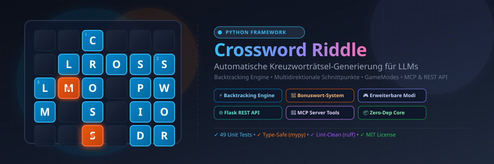

<p align="center">
  
</p>

<p align="center">
  <a href="https://python.org"></a>
  <a href="LICENSE"></a>
  <a href="test_framework.py"></a>
  <a href="#mcp-server"></a>
  <a href="#rest-api"></a>
</p>

---

## 📖 Dokumentation & Handbuch

Dieses **README** bietet eine schnelle, vollständige und präzise Übersicht über das **Crossword Riddle Framework**.

Suchen Sie nach tiefgehenden Architektur-Diagrammen, UML-Klassendiagrammen, Sequenzdiagrammen oder JSON-Schemas? Rufen Sie unser zentrales Handbuch auf:

👉 **[Entwickler- und Benutzerhandbuch (HANDBUCH.md)](HANDBUCH.md)**

---

## 💡 Übersicht

Das **Crossword Riddle Framework** ist eine spezialisierte Python-Bibliothek zur automatischen Generierung von 2D-Kreuzworträtseln. Es wurde speziell für die Integration mit **Large Language Models (LLMs)** und KI-Agenten konzipiert.

### Das gelöste Problem
LLMs besitzen herausragendes Allgemeinwissen und kreative Sprachfähigkeiten, scheitern jedoch regelmäßig an **geometrischen und räumlichen Beschränkungen** (wie zweidimensionalen Schnittpunkten von Wörtern, Wortlängen oder Kollisionsprüfungen).

Das Crossword Riddle Framework nimmt dem LLM die technische Komplexität ab:
1. **Das LLM liefert die Inhalte**: Fragen, Antworten und gewünschte Ausrichtungen.
2. **Das Framework übernimmt die Geometrie**: Algorithmisches Rekursiv-Backtracking, Wortkreuzungsprüfungen, Randkontrollen und Parallelitätsprüfungen.
3. **Präzises Feedback**: Wenn Wörter geometrisch nicht zusammenpassen, liefert das Framework strukturierte Korrekturhinweise, mit denen das LLM gezielt nachbessern kann.

---

## ✨ Hauptmerkmale

- ⚡ **LLM-optimierte API (`LLMKreuzwortAPI`)**: Liefert verlässliche Dictionaries mit klarem `"status"`-Feld (`success`, `error`, `validation_errors`, `generation_failed`, `problems_found`).
- 🔄 **Rekursive Backtracking Engine**: Platziert Wörter optimal im 2D-Gitter mit Unterstützung für Permutations- und Monte-Carlo-Fallbacks bei komplexen Wortmengen.
- 🎁 **Progressives Bonuswort-System (`BonusRevealSystem`)**: Baut ein übergeordnetes Lösungswort schrittweise aus den verfügbaren Buchstaben des generierten Gitters auf.
- 🎮 **Erweiterbare Spielmodi (`GameModes`)**: Flexible Anpassung der Rätsellogik (z. B. `ThemeBasedRiddle`, `NumberRiddle`, `ReverseRiddle`).
- 🌐 **Flask REST API**: Thread-sichere HTTP-Schnittstelle mit Session-Verwaltung für Remote-Integrationen.
- 🤖 **Model Context Protocol (MCP) Server**: Native Anbindung an MCP-fähige Clients wie Claude Desktop, Cursor oder VS Code (8 Tools).
- 📦 **Zero Core Dependencies**: Die Kernbibliothek benötigt ausschließlich die Python-Standardbibliothek.

---

## 🚀 Installation & Voraussetzungen

### Systemvoraussetzungen
- **Python**: 3.8 oder höher (empfohlen: Python 3.12)
- **Kern-Bibliothek**: Keine externen Abhängigkeiten erforderlich!

### Installation

```bash
# Repository klonen
git clone https://github.com/example/crossword-riddle.git
cd crossword-riddle

# Optional: Abhängigkeiten für REST API, MCP Server und Test-Runner installieren
pip install -r requirements.txt
```

#### Inhalt von `requirements.txt`:
- `flask` (REST API Server)
- `mcp` (Model Context Protocol Integration)
- `pytest` (Test-Framework)

---

## ⚡ Schnellstart & Code-Beispiele

### 1. Grundlegende Nutzung (`LLMKreuzwortAPI`)

```python
from kreuzwortriddle import LLMKreuzwortAPI

# Initialisiere die API mit einer Gittergröße von 15x15
api = LLMKreuzwortAPI(width=15, height=15)

# Fragen und Antworten hinzufügen
api.add_question("Hauptstadt von Deutschland", "Berlin", "horizontal")
api.add_question("Fluss durch Dresden", "Elbe", "vertical")
api.add_question("Süddeutsches Bundesland", "Bayern", "horizontal")

# Inputs validieren
validation = api.validate_all()
print("Validierung:", validation)
# -> {'status': 'valid', 'message': 'Alle Fragen sind gültig'}

# Rätsel-Gitter generieren
generation = api.generate()
print("Generierung:", generation)
# -> {'status': 'success', 'message': 'Riddle generated successfully'}

# Gitter im Terminal ausgeben
if generation["status"] == "success":
    grid = api.get_grid()
    for row in grid:
        print(" ".join(cell if cell else "." for cell in row))

    # Genaue Wort-Platzierungen abfragen
    placements = api.get_placements()
    for p in placements:
        print(f"#{p['number']} [{p['orientation']}] {p['answer']} an (x={p['x']}, y={p['y']})")
```

---

### 2. Bonuswort-System (`BonusRevealSystem`)

Das Bonuswort-System erlaubt das stufenweise Aufdecken eines Lösungswortes über die im Gitter platzierten Buchstaben.

```python
from kreuzwortriddle import LLMKreuzwortAPI

api = LLMKreuzwortAPI()
api.add_question("Hauptstadt von Deutschland", "Berlin", "horizontal")
api.add_question("Fluss durch Dresden", "Elbe", "vertical")

if api.generate()["status"] == "success":
    # Bonuswort setzen
    api.set_bonus_word("BERLIN")
    print(api.get_bonus_word_hint())
    # -> Bonuswort: ______ (0/6 Buchstaben, in Arbeit)

    # Nächsten Buchstaben schrittweise enthüllen
    letter = api.reveal_next_bonus_letter()
    print("Aufgedeckter Buchstabe:", letter)  # 'B'
    print(api.get_bonus_word_hint())
    # -> Bonuswort: B_____ (1/6 Buchstaben, in Arbeit)
```

---

### 3. Spielmodi verwenden (`modes.py`)

```python
from kreuzwortriddle import LLMKreuzwortAPI
from modes import ThemeBasedRiddle, NumberRiddle, ReverseRiddle

api = LLMKreuzwortAPI()

# Beispiel 1: Themenfilter aktivieren
api.set_game_mode(ThemeBasedRiddle("Hauptstadt"))
api.add_question("Hauptstadt von Frankreich", "Paris", "horizontal")  # WIRD ÜBERNOMMEN
api.add_question("Ein Obst", "Apfel", "vertical")                      # WIRD GEFILTERT

# Beispiel 2: Zahlenrätsel (erlaubt Ziffern in Antworten)
# api.set_game_mode(NumberRiddle())

# Beispiel 3: Umgekehrtes Rätsel (dreht Antworten automatisch um)
# api.set_game_mode(ReverseRiddle())
```

---

## 📐 Modularchitektur & Projektstruktur

Das Framework ist modular aufgebaut und trennt Kernlogik, Datenmodelle, Algorithmen und Schnittstellen sauber voneinander:

```
crossword-riddle/
├── assets/
│   └── banner.svg             # Projektbanner
├── models.py                  # Dataclasses: Question, WordPlacement, Orientation, ValidationError
├── grid_generator.py          # Backtracking-Algorithmus zur Gitterplatzierung (GridGenerator)
├── bonus_system.py            # Standalone Bonuswort-Logik (BonusSystem)
├── gamemode.py                # Abstrakte Basisklasse GameMode
├── modes.py                   # Concrete GameModes (ThemeBasedRiddle, NumberRiddle, ReverseRiddle)
├── kreuzwortriddle.py         # Haupt-Orchestrierung (KreuzwortRiddle) & LLM API (LLMKreuzwortAPI)
├── rest_api.py                # Flask REST-API Server (Session-basiert)
├── mcp_server.py              # Model Context Protocol Server (Stdio)
├── test_framework.py          # Test-Suite (49 Pytest Unit-Tests)
├── example_usage.py           # Runnable CLI-Demonstration
├── bonus_example.py           # Demo für das Bonuswort-System
├── HANDBUCH.md                # Umfassendes Entwickler- und Benutzerhandbuch
├── pyproject.toml             # Konfiguration für ruff, mypy und pytest
└── requirements.txt           # Optionale Paketabhängigkeiten
```

---

## 🌐 REST-API Referenz

Der REST-API Server (`rest_api.py`) erlaubt Remote-Systemen und Nicht-Python-Umgebungen den Zugriff auf das Framework.

### Server starten
```bash
python rest_api.py
```
*Läuft standardmäßig auf `http://0.0.0.0:5000`.*

### Endpunkte Overview

| Method | Endpoint | Beschreibung |
|---|---|---|
| `POST` | `/api/questions` | Neue Frage mit Fragetext, Antwort und Orientierung hinzufügen |
| `GET` | `/api/validate` | Alle aktuellen Fragen validieren |
| `POST` | `/api/generate` | Generiert das Gitter und gibt Gitter matrix & Platzierungen zurück |
| `GET` | `/api/problems` | Analysiert geometrische Unmöglichkeiten oder isolierte Wörter |
| `POST` | `/api/bonus` | Bonuswort setzen (`{"bonus_word": "..."}`) |
| `GET` | `/api/bonus` | Status und Hinweis des Bonuswortes abfragen |
| `POST` | `/api/bonus/reveal` | Deckt den nächsten verfügbaren Bonusbuchstaben auf |
| `GET` | `/api/status` | Gibt den Server- und Framework-Status zurück |
| `POST` | `/api/reset` | Setzt die API- und Bonus-Instanzen der Session zurück |

### cURL-Beispiel

```bash
# 1. Frage hinzufügen
curl -X POST http://localhost:5000/api/questions \
  -H "Content-Type: application/json" \
  -d '{"question": "Hauptstadt von Deutschland", "answer": "Berlin", "orientation": "horizontal"}'

# 2. Rätsel generieren
curl -X POST http://localhost:5000/api/generate
```

---

## 🤖 MCP Server (Model Context Protocol)

Das Framework beinhaltet einen nativer **MCP-Server** (`mcp_server.py`), mit dem LLM-Agents (z. B. Anthropic Claude, Cursor IDE) Rätsel über Stdio-Tool-Calls steuern können.

### MCP-Server starten
```bash
python mcp_server.py
```

### Registrierte MCP Tools
1. `add_question`: Fügt eine Frage hinzu.
2. `validate_all`: Validiert alle hinzugefügten Fragen.
3. `generate_riddle`: Erzeugt das 2D-Gitter.
4. `get_problems`: Liefert Problemanalysen und Korrekturvorschläge.
5. `set_bonus_word`: Setzt das aufzudeckende Bonuswort.
6. `reveal_bonus_letter`: Enthüllt den nächsten Bonusbuchstaben.
7. `get_status`: Fragt Zähler und Versionen ab.
8. `reset_framework`: Setzt die Rätselinstanz zurück.

---

## 🧪 Qualitätssicherung, Testing & Pre-Commit

Das Projekt garantiert höchste Stabilität durch eine umfassende Testabdeckung (**49 Unit-Tests**).

### Tests ausführen
```bash
# Automatisierte Pytest-Suite
pytest test_framework.py -v

# Alternativ mit unittest
python -m unittest test_framework.py
```

### Code-Qualität & Style Check
```bash
# Linter (ruff)
python -m ruff check .

# Type Checker (mypy)
python -m mypy kreuzwortriddle.py
```

---

## 📜 Lizenz & Beitragen

Dieses Projekt steht unter der **MIT License**. Siehe [LICENSE](LICENSE) für Details.

Beiträge, Issue-Meldungen und Feature-Wünsche sind herzlich willkommen! Bitte lesen Sie dazu auch unsere Guidelines in [CONTRIBUTING.md](CONTRIBUTING.md).
